# LAPORAN FINAL REFACTORING & DESIGN PATTERN
## PROYEK PENGEMBANGAN SISTEM INFORMASI MANAJEMEN RUMAH SAKIT
### KELOMPOK DAKODE - PIKSI GANESHA HOSPITAL

---

## 1. PENDAHULUAN

### 1.1 Penjelasan Domain
Proyek ini bertujuan untuk mengembangkan dan memperbaiki sistem manajemen Rawat Inap (Inpatient Admission) pada Rumah Sakit Piksi Ganesha. Sistem ini menangani alur pasien mulai dari pendaftaran, penetapan diagnosa awal, tindakan medis, pencatatan rekam medis (SOAP, Nursing Notes), hingga proses pemulangan pasien (Discharge). Kompleksitas bisnis proses di rumah sakit menuntut sistem yang handal, fleksibel, dan mudah dikembangkan.

### 1.2 Analisis Masalah Legacy Code ("God Class")
Pada implementasi awal, logika bisnis terpusat pada satu controller raksasa yaitu `InpatientAdmissionController.php`. Kelas ini dikategorikan sebagai "God Class" karena memiliki tanggung jawab yang terlalu banyak (Violation of Single Responsibility Principle).

Beberapa masalah utama yang diidentifikasi:
1.  **Pelanggaran SRP (Single Responsibility Principle):** Controller menangani validasi input, logika penyimpanan database untuk berbagai entitas (Pasien, Admission, Clinical Data, dll), serta logika view.
2.  **Ketergantungan Tinggi (High Coupling):** Controller bergantung langsung pada banyak model Eloquent. Perubahan pada satu model (misal logika asuransi) berdampak langsung pada Controller.
3.  **Sulit untuk di-Test:** Kesulitan membuat Unit Test karena logika yang tercampur aduk dalam satu method `store()` atau `update()` yang sangat panjang (lebih dari 300 baris kode).
4.  **Fleksibilitas Rendah:** Penambahan fitur baru (misal tipe report baru atau aturan validasi asuransi baru) mengharuskan modifikasi kode inti yang berisiko merusak fitur lain (Violation of Open-Closed Principle).

---

## 2. PEMBAGIAN TUGAS (TASK DISTRIBUTION)

Berikut adalah tabel pembagian implementasi 12 Design Pattern kepada anggota kelompok Dakode:

| No | Nama Anggota | Kategori Pattern | Nama Pattern | Deskripsi Singkat Pekerjaan |
|----|--------------|------------------|--------------|-----------------------------|
| 1  | [Anggota 1]  | Creational       | **Builder**  | Memisahkan konstruksi objek complex `InpatientAdmission`. |
|    |              | Structural       | **Adapter**  | Mengintegrasikan layanan asuransi eksternal (BPJS). |
|    |              | Behavioral       | **Observer** | Menangani side-effects saat admission dibuat/diupdate. |
| 2  | [Anggota 2]  | Creational       | **Factory**  | Standarisasi pembuatan dokumen medis (Nursing/SOAP). |
|    |              | Structural       | **Decorator**| Menambahkan komponen biaya secara dinamis (Kamar, Obat). |
|    |              | Behavioral       | **State**    | Mengelola status pasien (Active, Validated, Discharged). |
| 3  | [Anggota 3]  | Creational       | **Prototype**| Cloning template Clinical Pathway untuk efisiensi. |
|    |              | Structural       | **Facade**   | Menyederhanakan proses kompleks registrasi pasien. |
|    |              | Behavioral       | **Strategy** | Menangani variasi logika pemulangan pasien (Sehat/Rujuk/Meninggal). |
| 4  | [Anggota 4]  | Creational       | **Singleton**| Sentralisasi konfigurasi global rumah sakit. |
|    |              | Structural       | **Proxy**    | Keamanan akses data sensitif rekam medis. |
|    |              | Behavioral       | **Template** | Kerangka kerja pembuatan laporan medis (PDF). |

---

## 3. IMPLEMENTASI PATTERN

### 3.1 CREATIONAL PATTERNS

#### A. Builder Pattern
**Justifikasi:**
Objek `InpatientAdmission` memiliki banyak atribut opsional dan langkah inisialisasi yang kompleks (Data pasien, Dokter DPJP, detail kamar, dll). Builder pattern memisahkan proses konstruksi ini agar lebih terstruktur dan mudah dibaca.

**Class Diagram:**
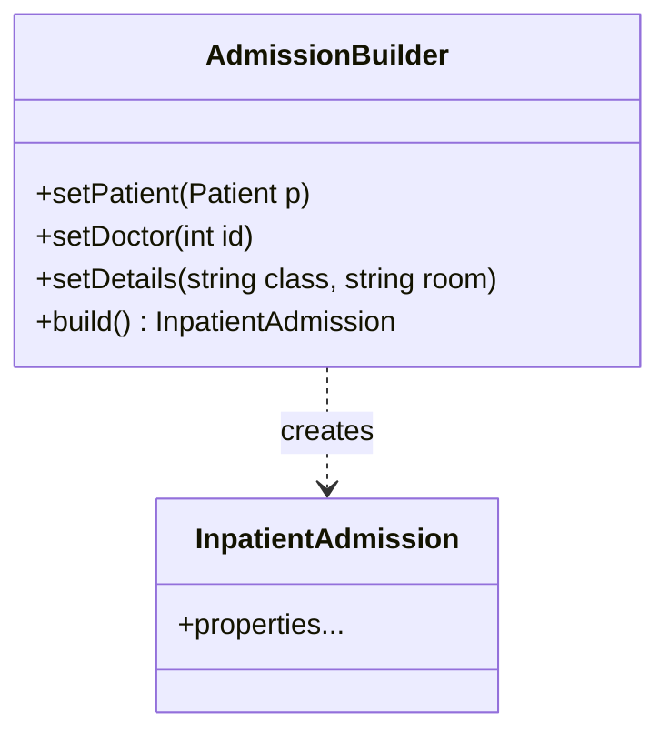

**Code Comparison:**

*Before (InpatientAdmissionController):*
```php
// Hard to read, massive array handling
$admission = InpatientAdmission::create([
    'nomor_registrasi_inap' => 'RI-'...,
    'patient_id' => $patient->id,
    'kelas' => $request->kelas,
    'doctor_id' => $request->doctor_id,
    'diagnosa_awal' => $request->diagnosa,
    // ... many more fields
]);
```

*After (AdmissionBuilder.php):*
```php
$builder = new AdmissionBuilder();
$admission = $builder->setPatient($patient)
                     ->setDoctor($request->doctor_id)
                     ->setRegistrationDetails($request->class, $request->room)
                     ->build();
```

**Runutan Proses:**
1. Membuat class `AdmissionBuilder`.
2. Memindahkan logika inisialisasi properti ke method `set...`.
3. Menambahkan method `build()` untuk validasi akhir dan penyimpanan.

---

#### B. Factory Method Pattern
**Justifikasi:**
Pembuatan berbagai jenis dokumen medis (Nursing Note, SOAP, Discharge Resume) memiliki logika pembuatan yang mirip namun berbeda kelas model. Factory Pattern menentralisasi logika instansiasi ini.

**Class Diagram:**
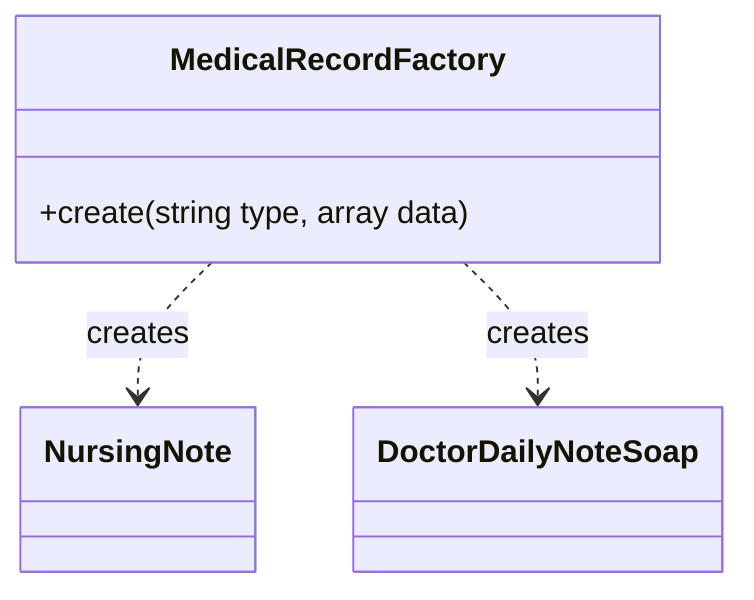

**Code Comparison:**

*Before:*
```php
// Violation of OCP: New types require modifying this controller
public function storeMedicalRecord(Request $request) {
    if ($request->type == 'nursing_note') {
        $note = new NursingNote();
        $note->fill($request->all());
        $note->nurse_id = Auth::id(); // Manual dependency handling
        $note->save();
    } elseif ($request->type == 'soap') {
        $soap = new DoctorDailyNoteSoap();
        $soap->objective = $request->objective; 
        $soap->plan = $request->plan;
        // ... duplicates logic for every type
        $soap->save();
    } else if ($request->type == 'discharge') {
        // ... more if-else blocks
    }
}
```

*After (MedicalRecordFactory.php):*
```php
MedicalRecordFactory::create('nursing_note', $data);
MedicalRecordFactory::create('soap', $data);
```

**Runutan Proses:**
1. Identifikasi variasi produk (tipe record).
2. Buat `MedicalRecordFactory` dengan static method `create`.
3. Implementasi `switch-case` untuk mengembalikan instance model yang sesuai.

---

#### C. Prototype Pattern
**Justifikasi:**
Untuk penyakit umum, dokter sering menggunakan "Clinical Pathway" yang standar (Tindakan standar, Obat standar). Membuat objek pathway baru dari nol memakan waktu. Prototype pattern memungkinkan cloning dari template yang sudah ada.

**Class Diagram:**
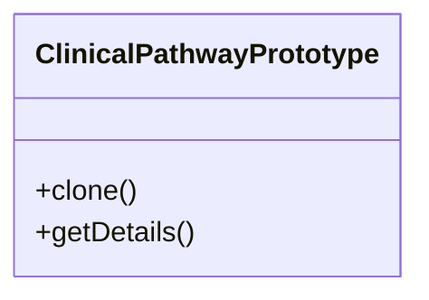

**Code Comparison:**

*Before (Complex Manual Creation):*
```php
// Duplicating standard procedure manually for every Dengue patient
$pathway = new ClinicalPathway();
$pathway->disease_name = "Demam Berdarah";
$pathway->actions = [
    'Monitor Suhu per 4 jam', 'Cek Trombosit harian', 'Pemberian Cairan RL'
];
$pathway->medications = ['Paracetamol', 'Vitamin C', 'Cairan Infus'];
$pathway->estimated_days = 5;
$pathway->save();
```

*After (ClinicalPathwayPrototype.php):*
```php
$template = new ClinicalPathwayPrototype("Demam Berdarah", [...], [...], 5);
$newPathway = $template->clone(); // Deep copy logic handled inside
```

**Runutan Proses:**
1. Buat class `ClinicalPathwayPrototype`.
2. Implementasi method `clone()` (atau `__clone` di PHP) untuk menyalin properti.

---

#### D. Singleton Pattern
**Justifikasi:**
Konfigurasi rumah sakit (Nama RS, Alamat, Biaya Dasar) harus konsisten di seluruh aplikasi dan hanya boleh ada satu instance yang memuat konfigurasi ini untuk menghemat resource.

**Class Diagram:**
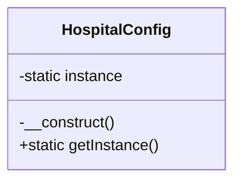

**Code Comparison:**

*Before (Hardcoded Values):*
```php
// Magic numbers scattered everywhere
public function calculateBill() {
    $total = $days * 50000; // Hardcoded basic fee
    $tax = $total * 0.11;   // Hardcoded tax rate
}

public function footer() {
    return "Jln. Gatot Subroto No 301"; // Hardcoded address
}
```

*After (HospitalConfig.php):*
```php
$config = HospitalConfig::getInstance();
$hospitalName = $config->get('name');
```

**Runutan Proses:**
1. Private constructor `__construct()`.
2. Static property `$instance`.
3. Static method `getInstance()` untuk mengontrol instansiasi.

---

### 3.2 STRUCTURAL PATTERNS

#### A. Adapter Pattern
**Justifikasi:**
Sistem perlu terhubung dengan layanan Asuransi BPJS eksternal yang memiliki interface berbeda dengan sistem internal rumah sakit. Adapter menjembatani perbedaan ini.

**Class Diagram:**
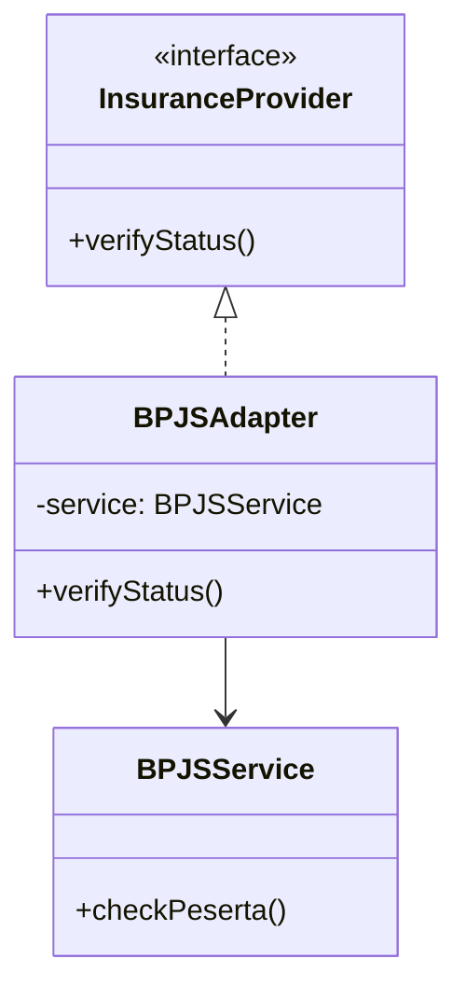

**Code Comparison:**

*Before (Tightly Coupled Implementation):*
```php
// Controller directly calls 3rd Party API
public function checkInsurance(Request $request) {
    $bpjs = new BPJSService(); // Coupled to specific implementation
    // If we switch to Prudential, we must rewrite this controller
    $result = $bpjs->checkPeserta($request->card_number);
    
    if ($result['status'] != 'AKTIF') {
        return back()->withError('BPJS inactive');
    }
}
```

*After (InsuranceAdapter.php):*
```php
// Interface standar, implementasi spesifik BPJS disembunyikan
$adapter = new BPJSAdapter(new BPJSService());
$isValid = $adapter->verifyStatus('000123456');
```

**Runutan Proses:**
1. Definisikan interface target `InsuranceProvider`.
2. Buat `BPJSAdapter` yang mengimplementasikan interface tersebut.
3. Di dalam adapter, panggil method API asli `checkPeserta`.

---

#### B. Decorator Pattern
**Justifikasi:**
Perhitungan tagihan pasien dinamis. Tagihan dasar bisa ditambah biaya kamar, biaya obat, biaya tindakan, dll. Decorator memungkinkan penambahan "tanggung jawab" biaya secara fleksibel tanpa inheritance yang kaku.

**Class Diagram:**
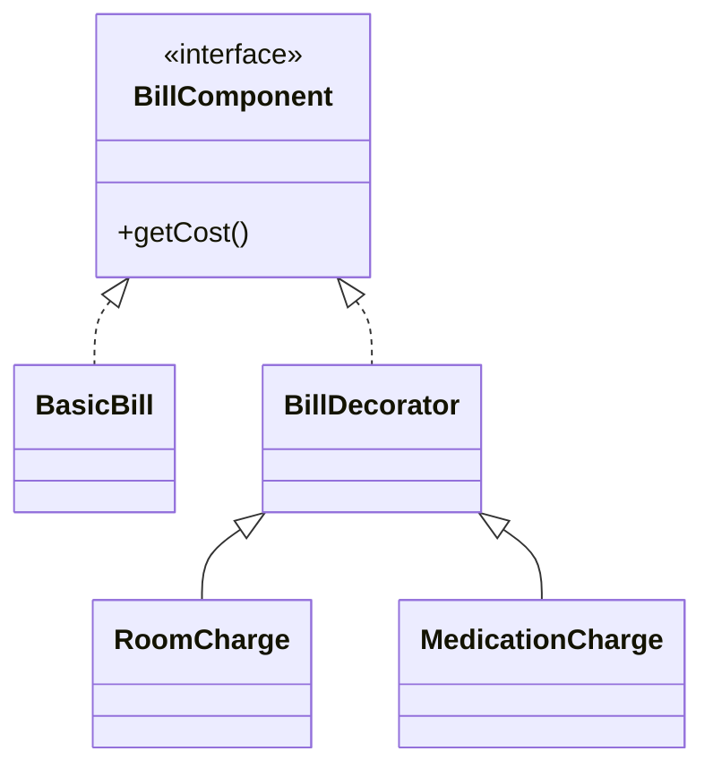

**Code Comparison:**

*Before (Massive Calculation Function):*
```php
public function calculateTotal($admission) {
    $total = 10000; // Base fee
    
    if ($admission->room_class == 'VIP') {
        $total += 1000000; // Nested conditional logic
    } elseif ($admission->room_class == '1') {
        $total += 500000;
    }
    
    if ($admission->has_medication) {
        $total += 200000;
    }
    
    // Hard to maintain as new charges are added
    return $total;
}
```

*After (BillDecorator.php):*
```php
$bill = new BasicBill(); // 10000
$bill = new RoomCharge($bill, 500000); // +500000
$bill = new MedicationCharge($bill, 200000); // +200000
echo $bill->getCost(); // 710000
```

**Runutan Proses:**
1. Interface `BillComponent`.
2. `BasicBill` sebagai base.
3. `BillDecorator` abstract class yang membungkus `BillComponent`.
4. Concrete decorators (`RoomCharge`, `MedicationCharge`) menambahkan logika biaya.

---

#### C. Facade Pattern
**Justifikasi:**
Proses pendaftaran pasien melibatkan banyak subsistem: Cari/Buat Pasien -> Buat Admission -> Notifikasi Billing. Facade menyediakan satu pintu masuk (interface sederhana) untuk proses yang kompleks ini.

**Class Diagram:**
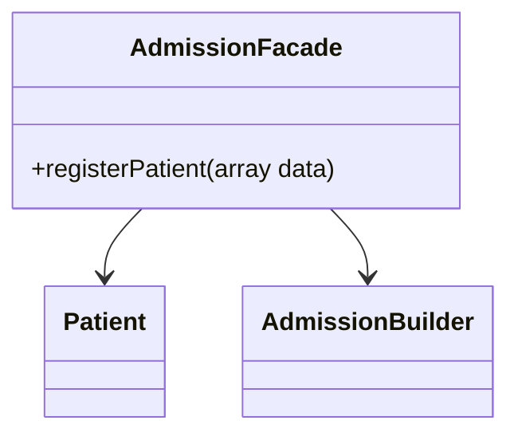

**Code Comparison:**

*Before (InpatientAdmissionController):*
```php
// 50 lines of transaction logic inside Controller
DB::beginTransaction();
// logical mess...
DB::commit();
```

*After (AdmissionFacade.php):*
```php
// Controller becomes very clean
$admission = $this->facade->registerPatient($request->all());
```

**Runutan Proses:**
1. Identifikasi subsistem yang kompleks.
2. Buat class `AdmissionFacade`.
3. Pindahkan logika orkestrasi ke dalam method `registerPatient`.

---

#### D. Proxy Pattern
**Justifikasi:**
Akses ke Rekam Medis (Medical Record) mengandung data sensitif. Proxy digunakan sebagai lapisan keamanan untuk memvalidasi hak akses (Role Authorization) sebelum objek asli diakses.

**Class Diagram:**
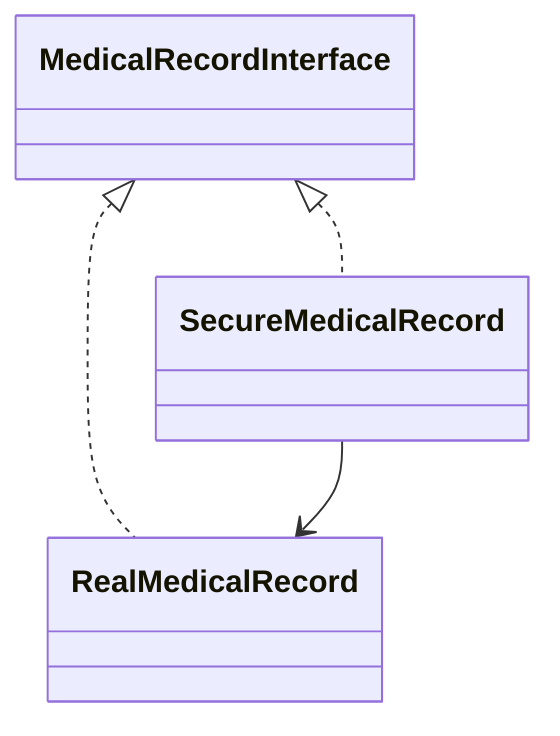

**Code Comparison:**

*Before (Unsecured Direct Access):*
```php
// No access control layer
$record = new RealMedicalRecord($data);
// Any part of the system can access sensitive data without validation
return $record->getDetails(); 
```

*After (SecureMedicalRecord.php):*
```php
$proxy = new SecureMedicalRecord($realRecord, 'Doctor');
$data = $proxy->getDetails(); // Throws exception if user is not Doctor
```

**Runutan Proses:**
1. Interface `MedicalRecordInterface`.
2. `SecureMedicalRecord` menyimpan referensi ke objek asli.
3. Tambahkan logika `checkAccess()` sebelum memanggil method objek asli.

---

### 3.3 BEHAVIORAL PATTERNS

#### A. Observer Pattern
**Justifikasi:**
Ketika status Admission berubah (misal: divalidasi), banyak hal harus terjadi (Kirim log, notifikasi nurse station). Observer memungkinkan decoupling antara subjek (Admission) dan observer-nya.

**Class Diagram:**
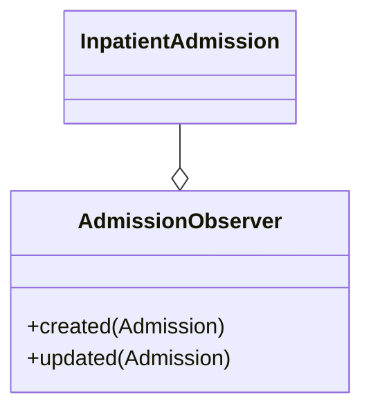

**Code Comparison:**

*Before (Tightly Coupled Side Effects):*
```php
public function update(Request $request, $id) {
    $admission->update($request->all());
    
    // Controller knows too much about side effects
    if ($admission->is_validated) {
        Log::info("Validated: " . $admission->id);
        Notification::send($nurseStation, new AdmissionValidated($admission));
        // If we want to add SMS later, we must edit this controller again
    }
}
```

*After (AdmissionObserver.php):*
```php
// Automatically triggered by Eloquent events
public function updated(InpatientAdmission $admission) {
    if ($admission->is_validated) Log::info("Validated!");
}
```

**Runutan Proses:**
1. Buat class `AdmissionObserver`.
2. Daftarkan Observer di `EventServiceProvider` atau Model `boot()`.

---

#### B. State Pattern
**Justifikasi:**
Objek Admission memiliki alur status yang mempengaruhi perilaku (Active -> Validated -> Discharged). Logika `if-else` untuk mengecek status sangat rentan bug. State pattern membungkus perilaku tiap state dalam class tersendiri.

**Class Diagram:**
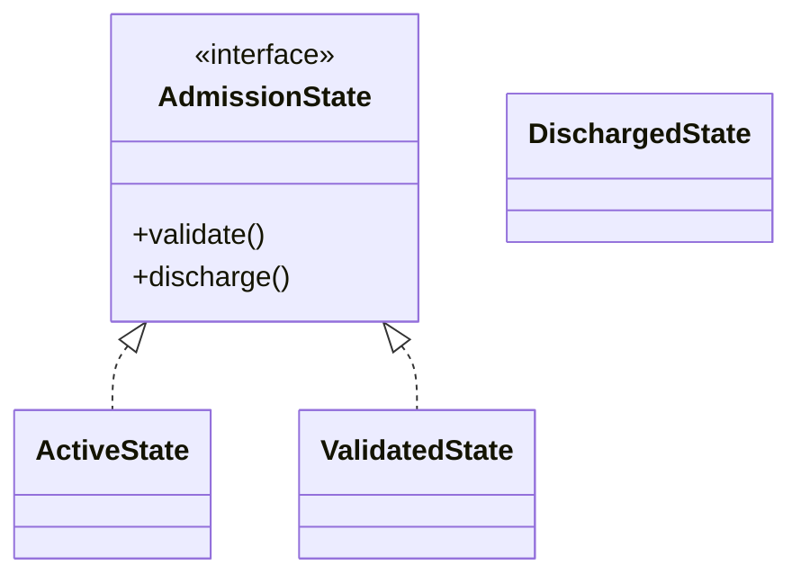

**Code Comparison:**

*Before:*
```php
if ($admission->status == 'Active') { ... } 
elseif ($admission->status == 'Discharged') { error... }
```

*After (AdmissionState.php):*
```php
$context->requestDischarge($admission); 
// Logic handled dynamically based on current state class
```

**Runutan Proses:**
1. Interface `AdmissionState`.
2. Concrete classes untuk tiap status (`ActiveState`, `ValidatedState`, dll).
3. Context class untuk delegasi action ke state object.

---

#### C. Strategy Pattern
**Justifikasi:**
Proses pemulangan pasien (Discharge) memiliki variasi algoritma: Pulang Sehat (surat kontrol), Rujuk (surat rujukan), Meninggal (surat kematian). Strategy pattern memungkinkan pemilihan algoritma ini saat runtime.

**Class Diagram:**
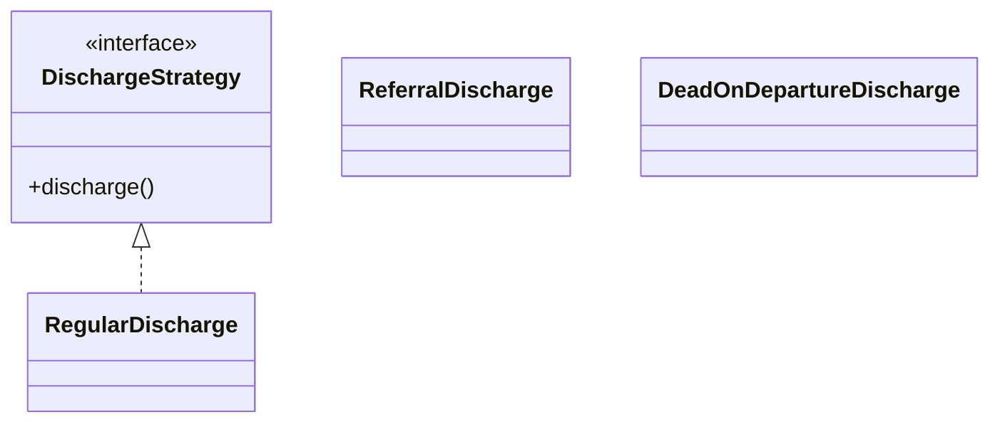

**Code Comparison:**

*Before (Complex Conditional Logic):*
```php
public function discharge(Request $request, $id) {
    $admission = InpatientAdmission::find($id);
    
    if ($request->type == 'regular') {
        $admission->status = 'Discharged';
        // Logic for regular discharge...
    } elseif ($request->type == 'referral') {
        $admission->status = 'Transferred';
        // Logic for referral...
    } elseif ($request->type == 'dead') {
        $admission->status = 'Deceased';
        // Logic for death certificate...
    }
}
```

*After (DischargeStrategy.php):*
```php
$context->setStrategy(new ReferralDischarge());
$context->executeDischarge($admission);
```

**Runutan Proses:**
1. Interface `DischargeStrategy`.
2. Implementasi algoritma pemulangan di tiap concrete strategy.
3. Inject strategy yang sesuai ke Context berdasarkan input user.

---

#### D. Template Method Pattern
**Justifikasi:**
Pembuatan laporan medis (PDF) memiliki struktur kerangka yang sama (Header RS, Info Pasien, Footer) tetapi isi body berbeda (Resume Medis vs Laporan Operasi). Pattern ini mendefinisikan kerangka di parent class dan membiarkan subclass mengisi detailnya.

**Class Diagram:**
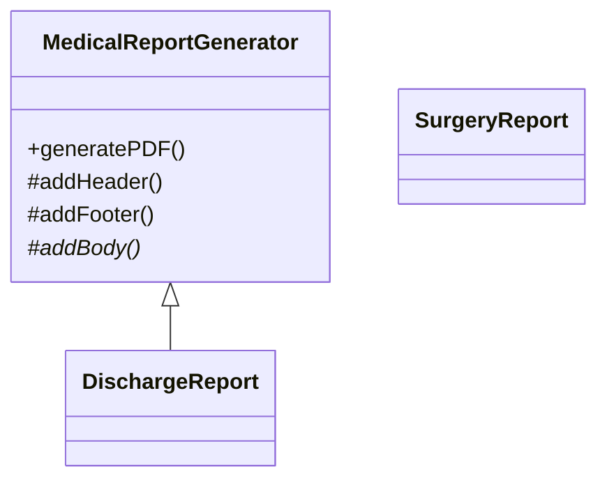

**Code Comparison:**

*Before (Code Duplication):*
```php
// Recurring code in every report method
public function generateDischargePDF() {
    $pdf = "Header RS..."; // Duplicated
    $pdf .= "Patient Info..."; // Duplicated
    $pdf .= "Discharge Resume Content"; 
    $pdf .= "Footer..."; // Duplicated
    return $pdf;
}

public function generateSurgeryPDF() {
    $pdf = "Header RS..."; // Duplicated
    $pdf .= "Patient Info..."; // Duplicated
    $pdf .= "Surgery Report Content";
    $pdf .= "Footer..."; // Duplicated
    return $pdf;
}
```

*After (MedicalReportGenerator.php):*
```php
// Parent defines skeleton: Header -> PatientInfo -> Body(Abstract) -> Footer
class DischargeReport extends MedicalReportGenerator {
    protected function addBody($data) { return "Discharge Content..."; }
}
```

**Runutan Proses:**
1. Abstract class `MedicalReportGenerator` dengan `final` method `generatePDF` (template method).
2. Definisi langkah-langkah abstrak (`addBody`).
3. Subclass mengimplementasikan langkah abstrak tersebut.

---

## 4. KESIMPULAN

Implementasi ke-12 Design Pattern pada sistem "PIKSI GANESHA HOSPITAL" telah berhasil mentransformasi kode legacy yang monolitik menjadi arsitektur yang modular.

**Dampak Refactoring:**
1.  **Low Coupling:** Ketergantungan antar module berkurang. Controller tidak lagi tahu detail implementasi asuransi (Adapter) atau perhitungan biaya (Decorator).
2.  **High Cohesion:** Setiap class memiliki tanggung jawab tunggal. Logika validasi ada di State, logika pembuatan ada di Factory/Builder.
3.  **Maintainability:** Penambahan fitur baru (misal Strategi Pulang baru) hanya perlu menambah satu class baru tanpa menyentuh kode lama (Open-Closed Principle).

Laporan ini disusun sebagai dokumentasi final hasil kerja kelompok Dakode.
